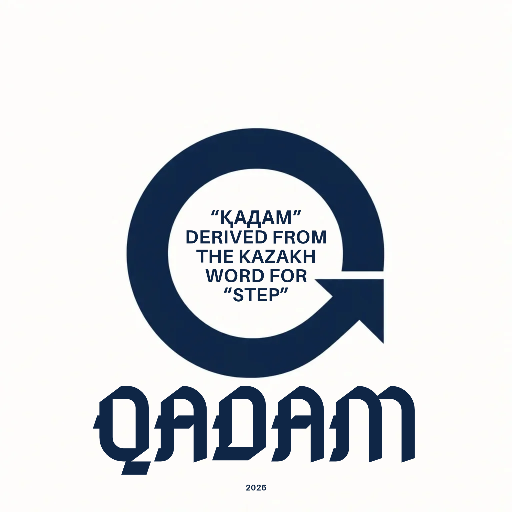

<p align="center">
  
</p>

<h1 align="center">QADAM Hub</h1>

<p align="center">
  <strong>Hackathons, grants and scholarships with deadlines quoted from the source.<br />Free for students worldwide, a workspace for schools.</strong>
</p>

<p align="center">
  <a href="https://www.qadamhub.com">www.qadamhub.com</a>
</p>

<p align="center">
  <a href="https://discord.gg/A4rxRGx4Vt"></a>
  <a href="https://t.me/QadamAgentBot"></a>
  
  
</p>

---

## What it is

QADAM means "step". Students find grants, hackathons, scholarships and internships in one place, and every listing is published only when its deadline is confirmed by a quote on the organizer's own page. Students use it for free, with no school or invite needed. Schools, universities and training centers get a workspace that shows who is preparing and who applied.

## Features

- **Opportunity Radar:** a daily scan publishes listings with a confirmed future deadline, a quoted source and a skill match for each student. Expired listings drop out.
- **CV and Skill Lab:** 235 skill quizzes (10 random questions, pass at 7, Verified badge) and a CV gap check against each listing.
- **Application Prep:** a checklist before applying on the organizer's site.
- **Teammates and Network:** profiles, friend requests, teams and chat, with email code sign-in.
- **Alerts:** Telegram and Discord bots.
- **Feedback button:** star rating and bug or idea reports from inside the app.
- **Schools workspace:** cohorts, invite links, a roster with application statuses and a CSV export.

A student profile is created in two steps and stays on the device until the student chooses to join the shared network.

## Messenger bots

- **Telegram (`@QadamAgentBot`):** `/start`, `/radar`, `/gaps`, `/privacy`, `/help`.
- **Discord:** `!radar`, `!gaps`, `!privacy`, `!broadcast`, `!help`, `!draft` (the draft text is a static example for now).

The bots read the published radar feed from the website. Server setup: [ORACLE_BOTS_SETUP.md](ORACLE_BOTS_SETUP.md).

## Tech stack

React 19, TypeScript, Vite, Tailwind CSS and React Router v7 on the front end. Supabase (Postgres with row level security and email code sign-in) for the shared network, the schools workspace and feedback. Vercel for hosting and serverless functions in `api/`. A Node.js radar scan run by a GitHub Action, Node.js bots with no dependencies, and optional Sentry error reports.

## Getting started

You need Node.js 22 or newer.

```bash
git clone https://github.com/Amir3003/qadamhub.git
cd qadamhub
npm install
cp .env.example .env        # on Windows: copy .env.example .env
npm run dev                 # http://localhost:5173
```

The app runs without any variables. Without the Supabase variables the shared network, the schools workspace and feedback storage are off and everything else works. Fill only the names you need in your own `.env`.

Build and full check, the same the CI expects:

```bash
npm run verify              # type check, then the production build
```

## Environment variables

Names only. Values live in your private `.env`, in Vercel, in GitHub Actions secrets or on the bot server, never in the repository. `.env.example` lists every name without values.

| Name | Where | Purpose |
|---|---|---|
| `VITE_SUPABASE_URL`, `VITE_SUPABASE_ANON_KEY` | build time, public | Client connection to Supabase. The key is public by design; row level security protects the data |
| `SUPABASE_SERVICE_ROLE_KEY`, `SUPABASE_URL` | server only | Used by `api/beta-feedback.js`. Never give it a `VITE_` prefix, it would reach the browser |
| `VITE_SENTRY_DSN` | build time, optional | Error reports |
| `VITE_REVIEW_URL` | build time, optional | A public review page shown after a 4 or 5 star rating |
| `VITE_LEGAL_NAME`, `VITE_LEGAL_ADDRESS`, `VITE_LEGAL_REGISTRATION_ID`, `VITE_CONTACT_EMAIL` | build time, optional | Operator details shown on the legal pages |
| `DATA_REQUEST_WEBHOOK_URL` | server only | Receives data requests from the Privacy page |
| `NEBIUS_API_KEY`, `TAVILY_API_KEY`, `NEBIUS_MODEL` | radar scan | Model and search access for the daily scan |
| `TELEGRAM_BOT_TOKEN`, `BOT_USERNAME`, `DISCORD_BOT_TOKEN`, `DISCORD_WEBHOOK_URL`, `DISCORD_INVITE_URL`, `WEB_APP_URL`, `RADAR_DATA_URL` | bot server | The bots |
| `VITE_QADAM_API_URL` | local development only | Reads the radar from a local API instead of the published file |

## Checks and tests

```bash
npm run test:network        # database rules, run in embedded Postgres
npm run test:feedback       # feedback API and its table
npm run check:quizzes       # quiz banks
node --test tests/radar-merge.test.mjs

npx playwright install chromium
npm run test:ui             # headless browser smoke test, desktop and mobile, starts its own server
npm run test:network-ui
npm run test:live           # checks the deployed site, LIVE_URL overrides the address
```

Semgrep also scans every pull request.

## Database and deployment

- SQL migrations are in `supabase/migrations/`. They are run by hand in the Supabase SQL editor, in file order. Setup notes: [NETWORK_SETUP.md](NETWORK_SETUP.md).
- Deploys go from `main` to Vercel. Work on a branch and open a pull request.
- The radar feed is published daily by a GitHub Action: [GITHUB_RADAR_SETUP.md](GITHUB_RADAR_SETUP.md). A local run on Windows: [LOCAL_SETUP.md](LOCAL_SETUP.md).

## Project structure

```
api/        Vercel serverless functions (data request, beta feedback)
backend/    Radar scan: search, extraction, quality rules and merge
bot/        Telegram and Discord bots, Discord server setup script
deploy/     Helper scripts for the bot server
docs/       Plans, setup notes and internal documents
public/     Static files, brand assets and the published radar feed
scripts/    Build scripts (prerender) and the quiz check
src/        The React app: pages, components, context, lib, db (quizzes, opportunities)
supabase/   SQL migrations
tests/      Node tests (database, API, radar) and Playwright specs
```

## Secrets and security

- `.env` and `.env.*` are ignored by git; only `.env.example`, which has no values, is committed.
- Server keys, bot tokens, webhooks and model keys belong only in Vercel, GitHub Actions secrets or the bot server.
- If a token, key or webhook was ever committed, treat it as leaked and rotate it. Deleting it from the file is not enough.
- Do not put personal data, private contact details or credentials into this file, the docs or an issue.
- To report a vulnerability, use GitHub's private vulnerability reporting for this repository, or contact the maintainers privately.

## License

MIT. See [LICENSE](LICENSE).
